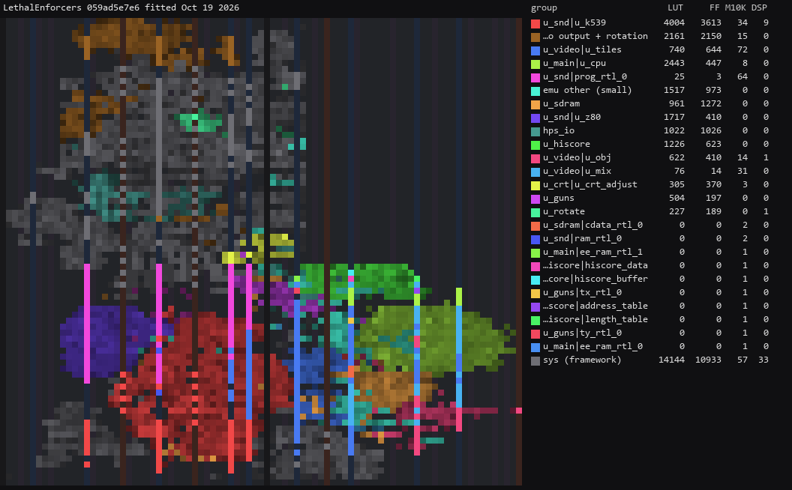
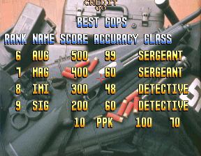
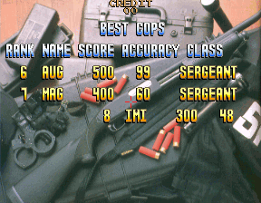

# Lethal Enforcers core for MiSTer

A MiSTer FPGA core for Konami's Lethal Enforcers (GX191) arcade hardware (MAME's
`konami/lethal.cpp`), built with Quartus Prime 17.0.2 Lite for the DE10-nano.

## Contents

- [History](#history)
- [Games](#games)
  - [Supported](#supported)
- [Hardware](#hardware)
  - [Video timing](#video-timing)
  - [Floorplan](#floorplan)
- [Screenshots](#screenshots)
- [Installation](#installation)
- [Controls](#controls)
- [Status](#status)
  - [Features](#features)
  - [Todo](#todo)
  - [Resource usage](#resource-usage)
- [AI Attestation](#ai-attestation)
- [Verification](#verification)
- [Acknowledgements](#acknowledgements)
- [Layout](#layout)
- [License](#license)

## History

**`Arcade-LethalEnforcers_20261019.rbf`**
* First release

## Games

The Lethal Enforcers board: one game, nine sets in MAME, all on the same hardware. The core needs
a 32 MB SDRAM module.

### Supported

Every MAME set has an `.mra`: the parent in `releases/`, the rest in
`releases/_alternatives/_Lethal Enforcers/`. `lethalen` and `lethalenj` have run on hardware; the
other seven use the same RTL with their own program ROM, EEPROM image and DIP switches, and have not
been run yet.

| Name | Set | Year | Manufacturer | Notes |
|-|-|-|-|-|
| Lethal Enforcers (ver UAE) | `lethalen` | 1992 | Konami | The parent. Screen mirrored vertically as in MAME (`ORIENTATION_FLIP_Y`) |
| Lethal Enforcers (ver UAB) | `lethalenub` | 1992 | Konami | |
| Lethal Enforcers (ver UAA) | `lethalenua` | 1992 | Konami | No hiscore saving (no `hiscore.dat` entry) |
| Lethal Enforcers (ver unknown, US, hacked/proto?) | `lethalenux` | 1992 | Konami | MAME notes it fails its own ROM test. No hiscore saving |
| Lethal Enforcers (ver EAE) | `lethaleneae` | 1992 | Konami | No Language switch, as MAME. No hiscore saving |
| Lethal Enforcers (ver EAD) | `lethalenead` | 1992 | Konami | No Language switch, as MAME |
| Lethal Enforcers (ver EAB) | `lethaleneab` | 1992 | Konami | No Language switch, as MAME. No hiscore saving |
| Lethal Enforcers (ver EAA) | `lethaleneaa` | 1992 | Konami | No Language switch, as MAME. No hiscore saving |
| Lethal Enforcers (ver JAD) | `lethalenj` | 1992 | Konami | Screen mirrored horizontally, gun axes reversed (`ORIENTATION_FLIP_X`, `PORT_REVERSE`). MAME lists no working DIP switches for it. No hiscore saving |

## Hardware

| Chip | Function | Status |
|-|-|-|
| HD63C09E | Main CPU, 3 MHz | `mc6809i` (Greg Miller) in jtcores' `jtframe_sys6809`, run as a 6809: a MAME trace found no 6309-only instructions. Bus trace checked against MAME |
| Z80B | Sound CPU, 6 MHz | T80 in jtcores' `jtframe_z80` |
| 054156 + 2 × 054157 | Four 8 bpp tilemaps | `lethal_tilemap.sv`, derived from KonamiGX's `gx_tilemap`. Every layer pixel of 23 MAME captures matches |
| 053245 + 2 × 053244 | Sprites, 6 bpp | jtcores' `jt053244`, extended to 6 bpp. Unzoomed sprites match MAME; zoomed ones differ (`docs/MAME_KLUDGES.md`) |
| Mixer, palette | Priority, shadows, xBGR 555 | Written here from `lethal.cpp` |
| 054000 | Collision protection | jtcores' `jtk054000` |
| 054321 | Sound latches, volume | jtcores' `jt054321`; its volume and enables in `lethal_k539.sv`, after MAME |
| 054539 | PCM sound, reverb | KonamiGX's `gx_k054539` in `lethal_k539.sv`. Within 1 LSB of MAME on every sample measured |
| ER5911 | EEPROM | jteeprom's `jt5911` |

### Video timing

A 6 MHz dot clock (24 MHz / 4), 384 dots by 262 lines: 15.625 kHz and 59.64 Hz, with 288 × 224
visible (dots 24-311, lines 16-239). From `lethal.cpp`'s `set_raw`, whose comment gives 59.638 Hz
as measured. The core runs on a 48 MHz clock, eight clocks a dot. Display aspect 4:3.

### Floorplan

Where the logic sits on the Cyclone V, read from the compiled design with
`scripts/floorplan.py`. One cell per LAB, M10K or DSP site, coloured by the block owning most of
it, brighter when fuller. The thin columns are M10K and DSP; the empty area at the top right is the
HPS; grey is the MiSTer framework. LUT counts are combinational cells, two per ALM.

The release revision at `059ad5e`, fitted 19 October 2026. Per-block counts are in
`docs/floorplan/LethalEnforcers_groups.md`.

## Screenshots

### Lethal Enforcers (ver UAE)

### Lethal Enforcers (ver JAD)

## Installation

A 32 MB SDRAM module is required.

* Take the latest `*.rbf` from `releases/` and put it in `_Arcade/cores`, renamed to drop the
  `Arcade-` prefix (`Arcade-LethalEnforcers_YYYYMMDD.rbf` becomes `LethalEnforcers_YYYYMMDD.rbf`). MiSTer launches
  the highest-sorting match for `<rbf>LethalEnforcers</rbf>`, and a `LethalEnforcers_*.rbf` sorts above every
  `Arcade-LethalEnforcers_*.rbf`
* Take the `*.mra` files and the `_alternatives` folder from `releases/` and put them in `_Arcade`
  (or a subdirectory starting with an underscore, e.g. `_Arcade/_LethalEnforcers`)
* Put the MAME 0.289 merged ROM set `lethalen.zip` in `games/mame`

To run a development build instead: `python scripts/build_staged.py`, then `python scripts/deploy.py`
with a `mister.env` (see `scripts/deploy.py`).

## Controls

| Button | Does |
|-|-|
| Trigger (A) | Fire |
| Reload (B) | A shot off the screen, which is how the game reloads |
| Start, Coin | Player 1 and 2 on the first and second pad |
| Pause (L) | Holds the main CPU; the picture stays |
| Service (R) | The board's test switch |

Aiming, per player, from the OSD:

* the left analog stick: Auto (an axis pushed fully moves like the d-pad, otherwise absolute), Aim
  (always absolute, for light guns such as Sinden or GUN4IR) or D-pad (moves on any deflection);
* the d-pad, two units a frame;
* the mouse, for the player the OSD gives it: left button fires, right reloads.

The crosshair is on by default.

Keyboard, MAME's defaults: arrows / R F D G, buttons LCtrl LAlt Space LShift Z X / A S Q W E,
Start 1 / 2, Coin 5 / 6; F2 service switch, 9 / 0 service coins, P pause.

## Status

Known issues:
* None

`docs/MAME_KLUDGES.md` lists what is taken from MAME as behaviour and what is known not to be
right. `docs/HACKS.md` lists this core's own approximations. `docs/ROADMAP.md` is the plan and its
progress; `docs/LESSONS_LEARNED.md` is what it cost.

### Features

* DIP switches from the `.mra` (`DIP;` in the OSD): done (`lethalen`: language, game type, coin
  mechanism, sound output)
* Inputs: done
* CRT Adjust (H-Position, V-Shift, H-Size, V-Size): H-Position, V-Shift and H-Size built, not yet
  checked on hardware; no V-Size
* HDMI scaling (integer scale, crop, crop offset): built, not yet checked on hardware
* HDMI rotation (orientation): built, not yet checked on hardware
* Flip screen, HDMI and analog, from the OSD or the DIP (fake DIP where the game has none): the OSD
  (the game has no flip DIP); not yet checked against the unflipped frame turned 180 degrees
* HDMI-only options hidden under direct video: not yet
* Peripheral menus shown only for games that use them: n/a, every set uses the guns
* Rotary joysticks (Ikari Warriors controls, GRS keystroke mode), where used: n/a
* Light guns: mouse, analog stick and synthetic crosshair, where used: done
* Audio mix (Mono, None, 25%, 50%): built, as Stereo, 25%, 50%, Mono
* Hiscore saving (`hiscore.v`, with autosave): built for `lethalen`, `lethalenub` and
  `lethalenead`, the sets MAME's `hiscore.dat` covers; not yet checked on hardware
* NVRAM / EEPROM saved to the `.nvm` file: built, not yet checked on hardware
* Fast ROM loading via DDR: done
* Pause (with CPU suspended): built, not yet checked on hardware
* Sound: matches MAME in simulation, not yet heard on hardware
* Savestates (optional): not yet
* Cheats (optional): not yet

### Todo

- [ ] Hide the HDMI-only options under direct video

### Resource usage

The `LethalEnforcers` release revision at `059ad5e`, on the DE10-nano's Cyclone V 5CSEBA6, speed
grade 7, timing met (worst setup slack +3.634 ns on `clk_sys`, +0.511 ns on the framework's HDMI
clock):

| resource | used | available |
| --- | --- | --- |
| Logic (ALMs) | 16,769 | 41,910 |
| Block memory bits | 2,330,561 | 5,662,720 |
| RAM blocks | 310 | 553 |
| DSP blocks | 44 | 112 |
| PLLs | 3 | 6 |

RAM blocks are the resource to watch: the Z80's program (64 KB), the 054539's RAM (32 KB) and the
tilemap VRAM (40 KB used) are all on chip.

## AI Attestation

This core is being developed with heavy use of a frontier coding assistant (Claude).

## Verification

Not PCB-validated. MAME 0.289 is the accuracy reference, with its own acknowledged uncertainties
noted where they matter.

* Main CPU: `mc6809i` against MAME's bus trace, with replayed peripherals, through 36 vblank IRQs:
  323,623 writes of 323,623.
* Whole board from reset, nothing replayed: the main CPU's first 292,853 writes match MAME's; the
  first difference is an interrupt taken one instruction later. Frame 290 of the run is
  pixel-identical to MAME's frame 300.
* Video against MAME captures of `lethalen`, `lethalenj` and `lethaleneae`: the software model
  matches on all 23; the tilemap RTL matches the model on every layer pixel; whole RTL frames are
  pixel-identical on 10, the rest differing only on zoomed sprites.
* SDRAM: download and all four ports against MAME's regions with Micron's model, at the board's
  clock phase: 477 reads of 477.
* `.mra`: each image, assembled with mra-tools-c's rules, is byte-identical to the stream the RTL
  expects, built from MAME's regions.
* Sound: MAME's own 054539 register writes replayed into the RTL, against MAME's audio with its
  speaker effects off: 99.60% of 541,626 samples exact, all within 1 LSB. On the whole board the
  Z80's 35,126 writes to the 054539 match MAME's in order and value.

## Acknowledgements

- **Sorgelig** and the **MiSTer-devel team** for the
  [Template_MiSTer](https://github.com/MiSTer-devel/Template_MiSTer) framework.
- The **MAMEdev team** — R. Belmont and Nicola Salmoria for `lethal.cpp`, Olivier Galibert for
  `k054539.cpp` — for the driver and the device emulations that are this core's specification.
- **Jose Tejada (jotego)**, [jtcores](https://github.com/jotego/jtcores): `jtframe` (RAMs, the
  SDRAM controller, `jtframe_sys6809`, `jtframe_z80`), `jt053244`, `jtk054000`, `jt054321`, and
  `jt5911` from jteeprom.
- **Greg Miller** for `mc6809i`; **Daniel Wallner** and **Sorgelig** for T80.
- [Arcade-KonamiGX_MiSTer](https://github.com/ppriest/Arcade-KonamiGX_MiSTer): `gx_k054539`,
  `gx_guns`, the tilemap `lethal_tilemap` derives from, the DDR3 ROM loader, the CRT Adjust glue,
  the keyboard map, and its 054539 Python model.
- **Umberto Parisi (rmonic79)** for CRT Adjust; **Alan Steremberg** and **Jim Gregory** for
  `hiscore.v`.

`THIRD-PARTY.md` has the licences and where each file came from.

## Layout

Standard [Template_MiSTer](https://github.com/MiSTer-devel/Template_MiSTer) structure:

| path | contents |
| - | - |
| `sys` | MiSTer framework, vendored from the template, never edited |
| `rtl` | core source; vendored modules carry a `PROVENANCE.md` |
| `releases` | `.rbf` and `.mra` files; clones in `_alternatives` |
| `docs` | roadmap, workflow, release process, kludges, hacks, lessons |
| `sim` | Verilator and Icarus testbenches |
| `scripts` | build, deploy, capture and verification tooling |
| `debug` | reference captures from MAME used as ground truth (gitignored) |
| `roms` | your own MAME sets (gitignored, never committed) |

## License

GPL-3.0-or-later (see `LICENSE`). Imported components keep their own licences; `THIRD-PARTY.md` has
the detail and every modified vendored file states the change in its header.

Game ROMs contain copyrighted material and are not included. Obtaining them is your
responsibility.
